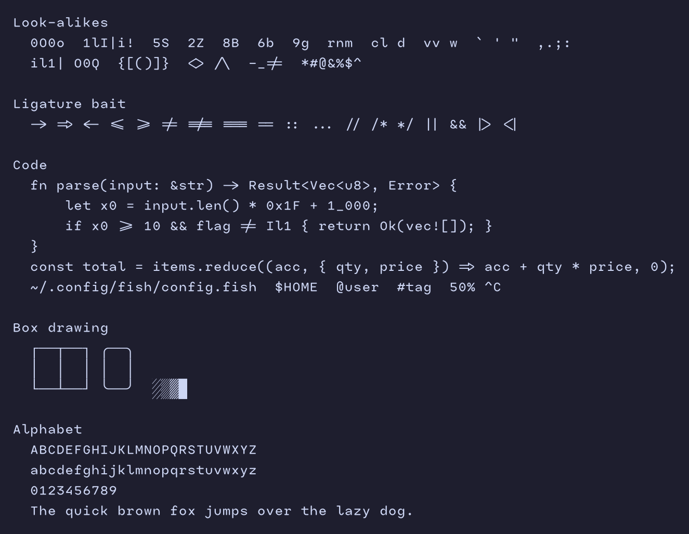

# Mote Mono

A monospace coding font: [Iosevka](https://github.com/be5invis/Iosevka) rebuilt with
proportions and letterforms inspired by Spot Mono, so it has small letters in a wide, tall
cell and soft, rounded stroke ends. It also has what Spot lacks for code: italics, Light
to Bold weights, ligatures, box drawing, powerline glyphs and Iosevka's full symbol coverage.



## Install

Download the zip from the [latest release](https://github.com/markryall/mote-mono/releases/latest)
and unzip it. Then:

- **macOS**: double-click each `.ttf` and choose Install, or copy them into `~/Library/Fonts`.
- **Linux**: copy them into `~/.local/share/fonts` and run `fc-cache -f`.
- **Windows**: select the `.ttf` files, right-click and choose Install.

Then set your editor or terminal font to `Mote Mono`.

It comes in Light, Regular, Medium and Bold, each with an italic. The fonts are unhinted:
they look right on macOS and on high-DPI screens, but can look soft on low-resolution
Windows displays.

## Ligatures

Arrows, comparisons, equality chains and a few more are on (`->` `=>` `<=` `!=` `===` `::`).
To switch them off, turn off the `calt` feature in your editor:
`"editor.fontLigatures": false` in VS Code, or `harfbuzz_features = { "calt=0" }` in WezTerm.

## Building

```sh
./build.sh            # build into tmp/iosevka/dist/MoteMono/TTF-Unhinted
./build.sh --install  # ...and copy into ~/Library/Fonts (macOS)
```

You need Node.js, Python 3 and git. The first build clones Iosevka into `tmp/` and installs
its dependencies, which takes a while.

- `private-build-plans.toml` is the Iosevka build plan: letterforms, metrics, weights,
  ligatures and the font's name metadata.
- `patches/` holds changes to Iosevka's source that the build plan can't express.
- `round-corners.py` rounds the square stroke ends Iosevka draws, after the build.

## License

[SIL Open Font License 1.1](LICENSE.md). Mote Mono is a modified version of Iosevka,
copyright Renzhi Li (Belleve Invis). Spot Mono was only a reference for proportions and
letter shapes: no glyphs or outlines were taken from it.
